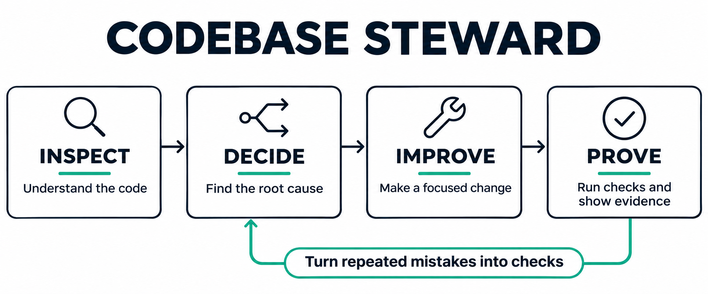

# Codebase Steward

**Better code. Fewer repeated mistakes. Evidence before “done”**

A practical skill for coding agents that fixes root causes, checks real behavior, and tells you when your codebase needs a better design

[](https://github.com/amrtawfik160/codebase-steward/actions/workflows/checks.yml)
[](LICENSE)

## Start in one minute

Install into your preferred agent using the [Skills CLI](https://skills.sh/docs/cli):

```sh
npx skills add amrtawfik160/codebase-steward
```

Then give your agent a normal task:

```text
Use codebase-steward to fix this bug
Check the real behavior, and tell me if the surrounding design needs improvement
```

That's it. You do not need to configure or run the optional tools yourself

The installer supports Claude Code, Codex, Cursor, and other compatible agents. It requires Node.js 22.20+. Prefer no installer? See [manual installation](docs/install.md)

## What you get

- **Focused changes:** understand the code before editing, and fix the cause rather than its symptoms
- **Honest verification:** separate what was observed from what merely compiled or was assumed
- **Useful architecture feedback:** concrete code evidence, practical impact, and a safe next step, not a demand for a rewrite
- **Enforced lessons:** turn repeated mistakes into types, lint rules, or tests rather than adding another paragraph of instructions
- **Two optional tools:** inventory a Git repo without executing its code, and enforce explicitly configured forbidden text

The core loop keeps small tasks focused. Multi-file bugs, boundary changes, and reviews load targeted references when needed. Bug fixes include a regression test shown to fail before the fix and pass afterward. Reviews check reachability and existing protections before reporting a defect.



## Three ways to use it

**Build or fix**

```text
Use codebase-steward to add password reset
Follow the existing conventions and verify the success and expired-link paths
```

**Review without editing**

```text
Use codebase-steward to review the billing module without changing files
Show the three most important problems, if any, with code evidence and a migration plan
```

**Stop a repeated mistake**

```text
We keep importing the old API client in new code
Use codebase-steward to replace the affected callers and add a check that prevents it returning
```

## Optional tools

Both tools use Node.js 22+ and Git, have no runtime dependencies, make no network requests, and never run your package scripts. Run them from a clone or let your agent resolve its installed skill directory

```sh
# Read-only inventory: packages, available checks, and review leads
node scripts/inspect.mjs --root /path/to/your-repo

# Enforce your repo's explicit .steward.json rules
node scripts/guard.mjs --root /path/to/your-repo
```

The inspector is not an architecture analyzer or a quality score. The guard matches literal text, including comments and strings; prefer your existing linter for semantic rules

The tools inspect tracked working-tree files, not untracked work or historical commits. They report coverage limitations rather than treating skipped work as proof. [Tool reference and examples](docs/tools.md)

## What a useful finding looks like

> **Hypothetical example: checkout and webhook both update payment state**
>
> Evidence: `checkout/complete.ts:42` and `webhooks/payment.ts:18` both write `paidAt`
>
> Contract and trigger: the order contract requires one payment transition. In an isolated test, replaying the same payment through both handlers records two transitions. Neither path uses the existing shared transaction
>
> Why it matters: the second transition emits a duplicate fulfillment request
>
> Recommended: move the transition into one shared operation, then migrate both callers
>
> Verify: repeated webhook delivery and checkout completion in either order produce one payment transition
>
> Scope: a separate change, not a silent addition to the current bug fix

## Boundaries

An audit stays read-only. Unrelated edits are preserved. Compatibility and useful comments are not deleted just to simplify code. Bigger redesigns are recommendations unless authorized

A skill guides an agent; it cannot force an agent to comply or prove that an application is correct. The scripts have automated fixture tests. The skill's behavioral checks are documented in [evaluation scenarios](docs/evaluation.md), not claimed as a model-quality benchmark

## Development

```sh
npm test
```

No dependency installation is needed. Tests use Node's built-in runner and temporary Git repositories. CI runs the same suite on Linux and Windows with Node 22 and 24

## License

[MIT](LICENSE) · [Third-party acknowledgments](NOTICE.md)
